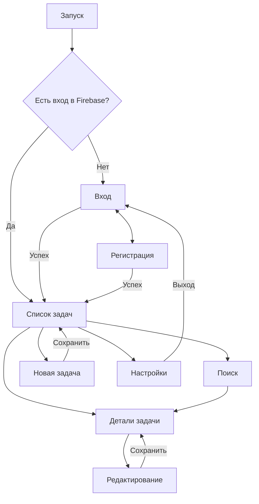

# Требования к приложению «Планировщик задач»

## Назначение

Личный планировщик задач для Android. После входа пользователь видит только
свои задачи, управляет их выполнением и находит нужную задачу поиском.
Интерфейс полностью на русском языке.

## Правила предметной области

Задача содержит название, необязательное описание, необязательный срок,
приоритет и статус. Название после удаления пробелов по краям имеет длину
от 1 до 120 символов. Описание — не более 2000 символов. Приоритет:
`LOW`, `MEDIUM`, `HIGH`; статус: `TODO`, `IN_PROGRESS`, `DONE`.
При создании по умолчанию используются `MEDIUM` и `TODO`. Срок хранится
в UTC, а в интерфейсе показывается в часовом поясе устройства. Прошедший
срок у незавершённой задачи отмечается как просроченный.

Только владелец может прочитать, изменить или удалить задачу. Владельца
сервер определяет по проверенному Firebase ID-токену; клиент не передаёт
идентификатор владельца в теле запроса.

## Функции первой полной версии

1. Регистрация, вход и сброс пароля по email через Firebase Authentication.
2. Выход из аккаунта и восстановление сессии при повторном запуске.
3. Просмотр списка своих задач и подробностей каждой задачи.
4. Создание, изменение, удаление и отметка выполнения задачи.
5. Фильтр по статусу и приоритету, сортировка по сроку или обновлению.
6. Поиск по названию и описанию на сервере.
7. История до 10 поисковых запросов на устройстве. Запрос попадает в
   историю после открытия результата поиска; повторный выбор перемещает
   его наверх. Историю можно полностью очистить.
8. Переключение светлой и тёмной темы с сохранением выбора.

Напоминания, совместные списки, вложения и повторяющиеся задачи в эту
версию не входят. Функциональность ограничена личным планированием задач.

## Экраны и переходы

Нижняя навигация ведёт к списку, поиску и настройкам. Кнопка «+» на
списке открывает форму создания. Нажатие на карточку открывает детали.

## Состояния поиска

| Состояние | Что видит пользователь |
|---|---|
| Поле пустое, история есть | До 10 последних запросов и «Очистить историю» |
| Поле пустое, истории нет | Подсказку «Найти задачу» |
| Введён текст | Кнопку «Очистить» |
| Запрос выполняется | Индикатор загрузки |
| Есть результаты | Карточки задач |
| Результатов нет | Плейсхолдер «Ничего не найдено» |
| Ошибка сети или сервера | Плейсхолдер с кнопкой «Обновить» |

При нажатии «Очистить» текст удаляется, клавиатура скрывается. Введённый
запрос сохраняется при повороте устройства. «Обновить» повторяет последний
запрос с теми же параметрами. История поиска разделена по Firebase UID,
поэтому другой пользователь на том же устройстве её не увидит.

## Нефункциональные требования

- Android-клиент и сервер написаны на Kotlin; клиент использует Compose,
  Clean Architecture, Hilt, Retrofit и Room, сервер — Ktor и PostgreSQL.
- Ktor и PostgreSQL запускаются на ноутбуке. Телефон обращается к Ktor
  по HTTP в той же доверенной Wi-Fi сети; адрес находится автоматически
  через UDP. Firebase Authentication использует HTTPS и требует интернета.
  Пароль БД не хранится в репозитории или Android-приложении.
- Сервер проверяет токен и принадлежность задачи при каждом защищённом
  запросе. Ошибки возвращаются в едином формате.
- Экран показывает загрузку, пустое состояние и ошибку без зависания.
- Основные действия доступны на телефоне шириной от 320 dp; для кнопок и
  полей предусмотрены читаемые подписи и достаточные области нажатия.
- Проверка включает модульные и UI-тесты, а также минимум 10 сценариев
  тестирования.

## Критерии готовности

Пользователь может зарегистрироваться, войти, создать задачу, увидеть её
после повторного запуска, изменить статус, найти её, удалить и выйти.
Второй аккаунт не получает доступ к задачам первого. Все перечисленные
состояния поиска и переключение темы воспроизводятся на эмуляторе.
