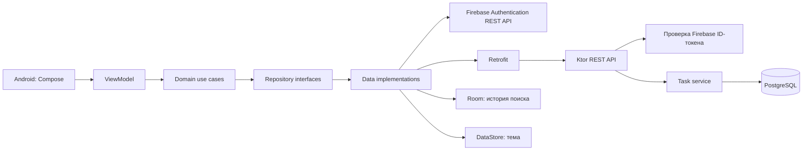

# Архитектура и взаимодействие компонентов

## Компоненты

Клиент сохраняет разделение `presentation → domain ← data`. `domain`
содержит модель задачи, правила ввода и интерфейсы репозиториев и не
зависит от Android, Firebase или Retrofit. Hilt связывает реализации с
интерфейсами. Сервер разделён на маршруты, сервисы и доступ к БД.

## Вход и доступ к данным

1. Android-клиент регистрирует или авторизует пользователя через Firebase
   Authentication по email и паролю через HTTPS API.
2. Перед запросом к Ktor клиент получает Firebase ID-токен и отправляет
   его в `Authorization: Bearer <token>`.
3. Ktor проверяет подпись токена по открытым сертификатам Google, срок действия,
   издателя и проект, затем получает UID. При первом
   обращении создаёт строку пользователя в PostgreSQL.
4. Все запросы к таблице задач ограничиваются этим UID. UID из параметров
   или тела запроса не принимается.
5. Если токен просрочен, клиент запрашивает свежий токен и повторяет запрос
   один раз. При повторной ошибке входа открывается экран авторизации.

Firebase применяется только для учётных записей. Задачи и история поиска
не хранятся в Firestore или Realtime Database. Пароль пользователя не
попадает на Ktor-сервер. Способ передачи и проверки ID-токена соответствует
[документации Firebase](https://firebase.google.com/docs/auth/admin/verify-id-tokens).

## Данные на устройстве

Room хранит историю поиска с полями `ownerUid`, `query`, `selectedAt`.
Уникальность пары `(ownerUid, query)` позволяет перемещать повторный
запрос наверх. После вставки удаляются записи сверх 10 для данного UID.
DataStore хранит одну настройку темы. Основным источником задач всегда
остаётся сервер; локальное редактирование без сети в этой версии не
предусмотрено.
Сессия Firebase сохраняется отдельно в зашифрованном виде с ключом из
Android Keystore. Пароль на устройстве не сохраняется.

## Разработка и демонстрация

При разработке Ktor и PostgreSQL запускаются локально. Эмулятор обращается
к Ktor через адрес хоста Android Emulator. Для итоговой демонстрации тот
же сервер подключается к удалённой PostgreSQL в Neon по строке подключения
из переменной окружения. Миграции БД одинаковы в обеих средах.

Для публичных репозиториев будут отдельные проекты клиента и сервера.
Строки подключения к базе данных и ключ Firebase API хранятся вне Git.
