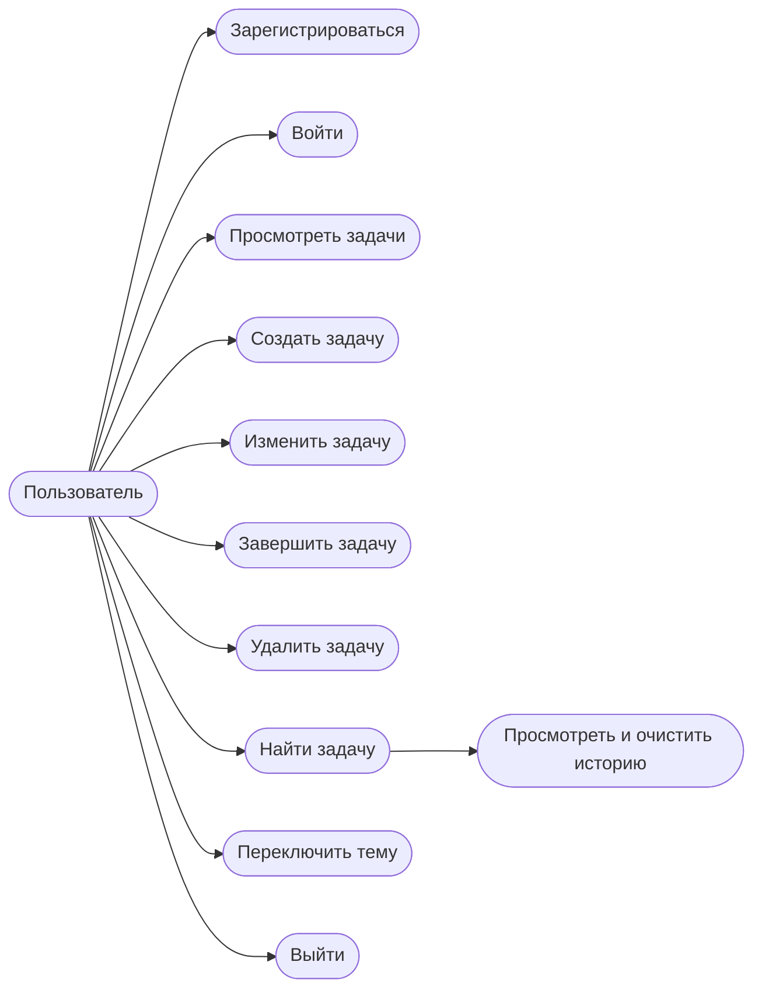
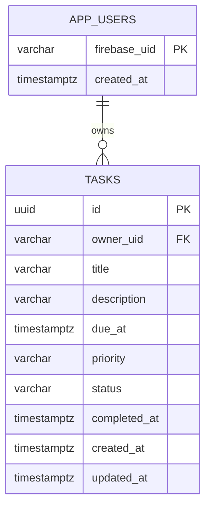
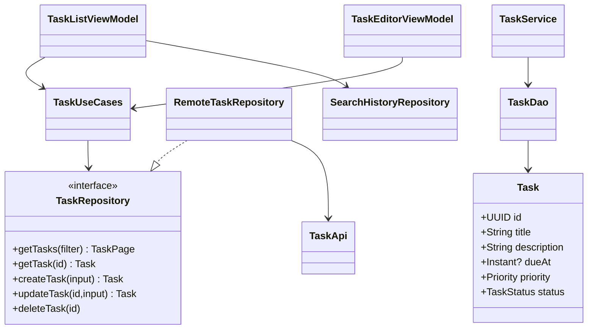
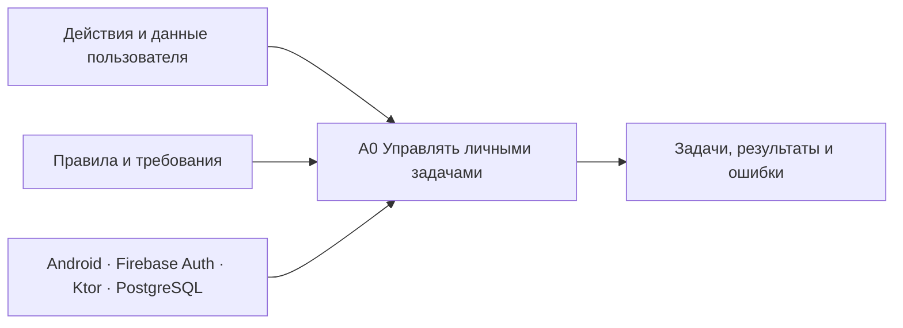

# Диаграммы проектирования

## Варианты использования

Операции с задачами и поиском доступны после входа. В каждом серверном
варианте использования проверяется токен и принадлежность данных
пользователю.

## Логическая модель БД

История поиска — отдельная локальная таблица Room с полями `ownerUid`,
`query`, `selectedAt`; она не синхронизируется с PostgreSQL.

## Классы и зависимости

Схема обобщает логические классы и зависимости компонентов; имена
обозначают роли в архитектуре, а не точные названия типов в исходниках.

## Функциональная модель A0 для IDEF0

Функция A0 — «Управлять личными задачами пользователя».

| Сторона блока | Потоки |
|---|---|
| Входы | Действия пользователя, данные задачи, поисковый запрос |
| Управление | Правила валидации, ограничения доступа, требования курсовой |
| Выходы | Список и детали задач, результат поиска, сообщения об ошибках |
| Механизмы | Android/Compose, Firebase Authentication, Ktor, PostgreSQL |

Декомпозиция A0: A1 «Подтвердить пользователя», A2 «Обработать задачу»,
A3 «Найти задачи», A4 «Отобразить результат». Приведённая схема
показывает потоки функции A0; отдельный чертёж IDEF0 в состав
документации проекта не входит.
